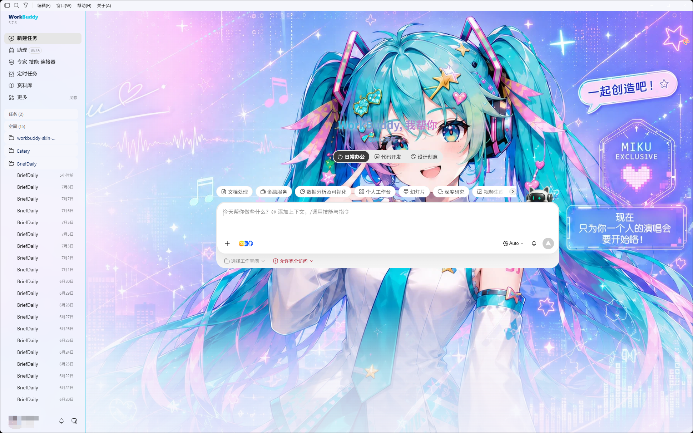
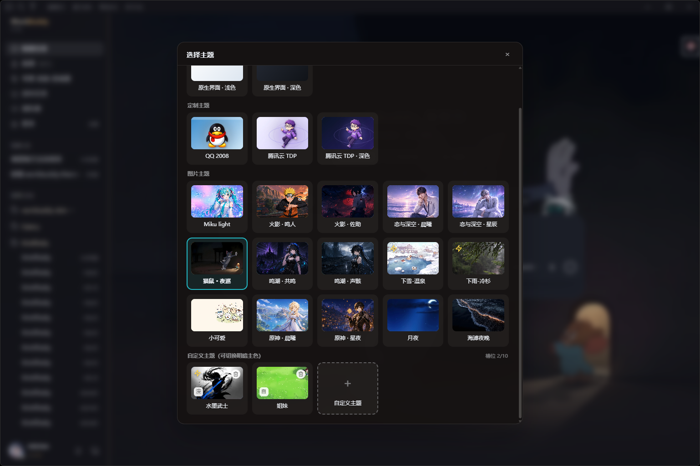
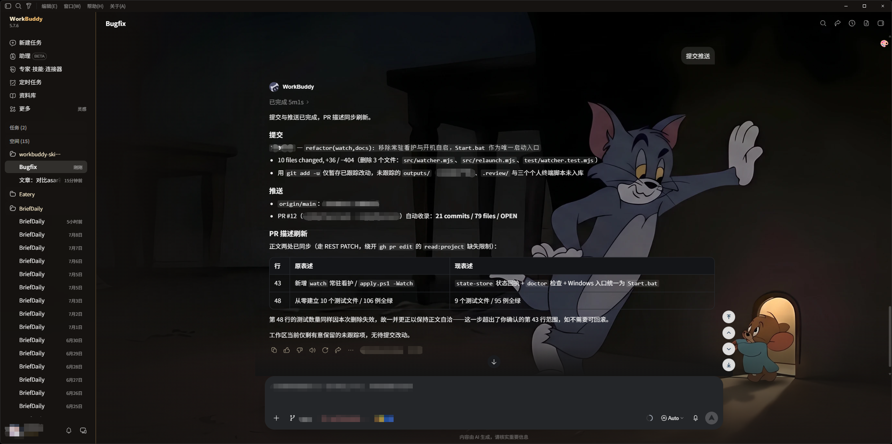

# WorkBuddy Skin Studio · WorkBuddy 换肤工作室

**给 WorkBuddy 桌面端换一张会呼吸的脸。**

一张图，一种心情 · 本机 CDP 注入 · 不改官方安装包 · macOS + Windows

非腾讯官方产品。不修改 `WorkBuddy.app` / `app.asar` / Windows 安装目录。

> **给 AI 助手**：如果你的用户把本仓库的 GitHub 地址发给你，并说"用这个开源项目帮我换 WorkBuddy 主题"，请直接阅读仓库根目录的 [`SKILL.md`](SKILL.md) —— 里面是给 AI 的自动化安装流程（平台检测、运行 apply 脚本、选主题、验证、还原），照做即可，无需人类逐步操作。

## 效果预览








## 这是什么

一个给 WorkBuddy 桌面端换肤的工具。通过本机回环 CDP 把主题实时注入 WorkBuddy 界面，不修改 `app.asar`，不破坏应用签名，也不需要为每次 WorkBuddy 更新重新适配。

- **一键切换**：应用皮肤后 WorkBuddy 右上角出现 🎨 菜单，所有已装主题和原生界面即点即换，零等待
- **自定义上传**：菜单里选「＋ 自定义皮肤」直接上传本地图片或 MP4 视频，自动按画面风格取色（主色、辅色、面板底色、文字色），即点即换；明暗默认按**主色亮度**自动判定，点行尾「自/浅/深」按钮可强制浅色或深色；最多 10 个自定义槽位各自保留，行尾 × 单独删除
- **一张图片就是一个主题**：任意 PNG、JPG、JPEG、WebP 直接生成皮肤（配色 + 背景底图）
- **动图背景**：GIF、动态 WebP、动态 AVIF 原样注入、保留动画播放（跳过 canvas 重编码，仍用第一帧取色）；动图限 3MB、最长边 1920px（体积为适配 localStorage 配额，分辨率为避免拖慢渲染）
- **视频背景**：MP4（H.264）抽帧取色，海报帧作 CSS 底图兜底，视频以固定背景层循环静音播放；原始视频存 IndexedDB（不占 localStorage 配额），限 30MB
- **15 个内置预设**：Miku、原神 ×2、鸣潮 ×2、火影忍者 ×2、恋与深空 ×2、猫鼠、海滩夜晚、小可爱、冷杉雨（MP4 视频）、月夜、温泉雪（MP4 视频）
- **深浅色自动适配**：根据主题配色的 surface 明度自动切换 WorkBuddy 的 `data-vscode-theme-kind`，让 VS Code 原生控件（输入框、按钮等）跟着深浅色变
- **双平台**：macOS（`.command`）+ Windows（`.ps1`）
- **随时还原**：暂停皮肤或切回原生界面，官方安装包始终原封不动

## 快速开始

需要已安装 WorkBuddy 桌面端。下载本仓库后：

### 用 AI 一键安装（推荐）

不想自己敲命令？把本仓库的 GitHub 地址发给任意 AI 助手（CodeBuddy / Claude / Cursor 等），再加上一句：

> 用这个开源项目帮我更换 WorkBuddy 的主题

AI 会克隆仓库、读取根目录的 [`SKILL.md`](SKILL.md)，自动完成**平台检测 → 运行对应 apply 脚本 → 注入主题 → 验证状态**，你只需在弹窗里保存好 WorkBuddy 当前任务即可。换肤后日常切换仍在右上角 🎨 菜单里进行。

> 想指定主题也可直接说，例如「用深色原神主题」或「帮我换成 miku-light」。

### macOS

```bash
# 双击 scripts/apply.command，或命令行：
./scripts/apply.command

# 或指定主题
node src/cli.mjs apply --theme genshin-night
```

### Windows

```powershell
# PowerShell 运行
.\scripts\apply.ps1

# 或指定主题
.\scripts\apply.ps1 -Theme genshin-night

# 若找不到 WorkBuddy.exe，先跑排查脚本：
.\scripts\find-workbuddy.ps1
```

也可以直接双击根目录的 `Start.bat`（内部调用 `apply.ps1`，行为一致）；命令行带主题 id 使用：`Start.bat genshin-night`。

> Windows 首次运行若报执行策略错误，执行：
> `Set-ExecutionPolicy -Scope CurrentUser RemoteSigned`

应用皮肤时 WorkBuddy 会被正常退出并以本机调试模式重新打开，**当前任务请先保存**。

之后的日常切换都在 WorkBuddy 右上角 🎨 菜单里完成。暂停皮肤、回到原生外观：

```bash
# macOS
./scripts/pause.command

# Windows
.\scripts\pause.ps1
```

> 注意：WorkBuddy 手动重启后注入会消失（CDP 方案的天性），重跑一次 apply 即可回来——不带主题参数时会自动恢复你上次在 🎨 菜单里选的皮肤（含自定义皮肤）。
>
> 不想每次手动重跑？用**看护模式**：`node src/cli.mjs watch`（或 Windows `.\scripts\apply.ps1 -Watch`）。它会常驻探测：WorkBuddy 以非调试模式重启时自动拉起并恢复皮肤；界面整页重载（皮肤掉了但调试端口还在）时直接重注；你主动退出 WorkBuddy 时它只待命，绝不擅自拉起。Ctrl+C 退出看护。

## 主题切换菜单

应用皮肤后，WorkBuddy 右上角（titlebar 下方）会出现 🎨 按钮：

- 点击展开主题列表，点击任意主题即时切换；点击面板外任意位置自动收起
- 视频主题与动图主题（GIF / 动态 WebP / 动态 AVIF / MP4）在列表行尾带「动态」「动图」标注
- 按钮悬浮在原生按钮行正下方、紧贴顶部工具栏下沿，水平位置跟随原生按钮行右缘（右侧详情栏打开时自动左移），不与原生按钮重叠
- 「＋ 自定义皮肤」上传本地图片或 MP4 视频生成主题（图片 canvas 自动取色 + 压缩成 webp；GIF/动态 WebP/动态 AVIF 保留动画不压缩，限 3MB、最长边 1920px；MP4 抽帧取色、海报帧兜底、循环静音播放，原始视频存 IndexedDB，限 30MB）
- 自定义主题最多 10 个槽位，每个独立持久化（元数据在 localStorage，视频文件在 IndexedDB），行尾 × 单独删除
- 「原生界面」恢复官方外观

## 右侧定位按钮

应用皮肤后，会话区域可滚动时右下角出现四个定位按钮：**回到顶部 / 上一个提问 / 下一个提问 / 回到底部**（悬停显示名称）：

- 滚动容器与提问锚点均为启发式探测（优先 `.messages-container`，回退「可滚动 + 占宽≥40% + 面积最大」；提问锚点优先 `data-role=user` 等选择器，回退消息列表直接子项），不依赖特定 DOM 版本
- 平滑滚动为 rAF 三次缓出（420ms），目标每帧按最新 `scrollHeight` 夹取——流式输出时「回到底部」能跟随增长到底；滚轮/触摸介入立即取消动画让出控制权
- 显隐按 rAF 合帧驱动（scroll 捕获监听 + 布局变更观察），容器不可滚动时自动隐藏

## 自定义主题

用任意图片创建主题：

```bash
node src/cli.mjs create --image "/path/to/hero.webp" --name "My Skin"
node src/cli.mjs apply --theme my-skin
```

或直接在 🎨 菜单里选「＋ 自定义皮肤」上传图片或 MP4 视频，自动取色并持久化（图片在 localStorage，视频在 IndexedDB）。

## 极简主题格式

```json
{
  "schemaVersion": 1,
  "id": "my-skin",
  "name": "My Skin",
  "hero": "hero.webp",
  "colors": {
    "accent": "#24C9D7",
    "secondary": "#EF8FD3",
    "surface": "#F7FBFF",
    "text": "#17344F"
  }
}
```

只有 `schemaVersion`、`id`、`name` 和 `hero` 必填。素材必须位于主题目录内，颜色和文案（`copy`）都可省略。

- `surface` 的明度决定 light/dark 模式（亮度 > 140 为 light），自动切换 WorkBuddy 的 `data-vscode-theme-kind`
- `hero` 支持 PNG / JPG / JPEG / WebP / GIF / AVIF / MP4（GIF、动态 WebP、动态 AVIF 保留动画播放；AVIF 需 Chromium 85+）
- `hero` 为 MP4（H.264，限 30MB）时是视频主题：必须再配 `poster` 海报帧图片作 CSS 底图兜底，视频在注入时预置进渲染进程 IndexedDB（按字节数判重，重复 apply 不重复传输），以固定背景层循环静音播放。示例：`"hero": "hero.mp4", "poster": "hero.webp"`

## 命令行

```bash
node src/cli.mjs list                              # 列出所有主题
node src/cli.mjs create --image PATH --name NAME   # 从图片创建主题
node src/cli.mjs apply [--theme ID] [--port 9223]  # 应用主题
node src/cli.mjs watch [--port 9223] [--interval 3000]  # 常驻看护：重启/重载后自动恢复皮肤
node src/cli.mjs status                            # 查询注入状态
node src/cli.mjs pause                             # 恢复原生（别名：restore）
node src/cli.mjs doctor                            # 检查环境（app 路径、端口、Node 版本、上次注入回执）
```

## 开发与测试

本仓库是纯 Node.js（ESM），无构建步骤、无第三方运行时依赖，只用 Node 内置模块。

```bash
node --version   # 需 Node 18+
npm test         # 运行 test/ 下的单元测试（等价于 node --test）
```

单元测试覆盖不依赖真实 WorkBuddy 的核心逻辑（用假 CDP Session / 假 WebSocket 与临时目录替代真实依赖，运行 WorkBuddy 与否都能跑通）：

- `test/theme-schema.test.mjs` — 主题清单校验：`poster` 规则（视频 hero 必填、图片 hero 禁填、必须是主题目录内的图片相对路径）与 `loadTheme` 的 realpath 逃逸防护（junction / symlink）、目录内合法符号链接、清单 JSON 报错带路径
- `test/injector.test.mjs` — 视频预置链路：4MB 分块切分与暂存清理、写入字节数校验、`Uint8Array.fromBase64` 快路径 + `atob` 回退 + 主线程让出、按尺寸判重跳过、单个渲染进程失败降级为警告、本地文件缺失降级；`applySkin` 每个渲染进程只开一条会话（视频预置失败时换新连接继续注入）；`removeSkin` 先调菜单 teardown
- `test/skin-menu.test.mjs` — 🎨 菜单注入脚本：生成脚本可被 JS 引擎编译、切换 / 上传 / 恢复原生各路径的异常兜底与错误日志、大图解码快路径、IndexedDB 阻塞与中止处理、重复注入 / 暂停时的 teardown（断观察者、解除明暗钉住、移除全局监听）、布局校准按 rAF 合帧、自定义主题列表缓存、自愈重挂（菜单/样式/定位按钮被框架移除后自动重挂，teardown 先断观察者再移除）、右侧定位按钮（四键齐全、容器/锚点启发式与兜底、平滑滚动、滚轮取消动画、显隐合帧、teardown 拆除）
- `test/theme-store.test.mjs` — 主题列表：多目录同 id 去重（内置优先）、缺 `name` 不再崩、跳过坏清单与 `.tmp-` 残留目录；`create` 名称校验
- `test/cdp-client.test.mjs` — CDP 会话：默认不 enable 任何域、`enableDomains` 显式开启与参数校验
- `test/cli.test.mjs` — `apply` 编排：坏主题不进菜单且保序、选中主题失败即报错、恢复上次自定义皮肤、记住的主题失效回退默认；状态回执（apply/pause 成败落盘、写失败不阻断）；`watch` 命令接线；`doctor` 的 Node 版本检查与状态展示
- `test/watcher.test.mjs` — 看护循环：页面重载重注、非调试重启拉起+重注、主动退出只待命、启动中不误判、失败退避翻倍（上限 60s）、探测异常落日志继续
- `test/state-store.test.mjs` — 状态回执：读写往返、浅合并、损坏文件回退 null、原子写入

## 内置主题

| 主题 id | 名称 | 风格 |
|---|---|---|
| `miku-light` | Miku Light | 青绿粉 · 浅色 |
| `genshin-dawn` | 原神 · 晨曦 | 蓝 · 浅色 |
| `genshin-night` | 原神 · 星夜 | 金 · 深色 |
| `deepspace-dawn` | 恋与深空 · 晨曦 | 紫 · 浅色 |
| `deepspace-star` | 恋与深空 · 星辰 | 紫 · 深色 |
| `naruto-hokage` | 火影 · 鸣人 | 橙 · 深色 |
| `naruto-sasuke` | 火影 · 佐助 | 红 · 深色 |
| `wuthering-echo` | 鸣潮 · 共鸣 | 青 · 深色 |
| `wuthering-tide` | 鸣潮 · 声骸 | 青 · 深色 |
| `mice-cat` | 猫鼠 · 夜巡 | 金 · 深色 |
| `beach-night` | 海滩夜晚 | 深蓝 · 深色 |
| `cutie` | 小可爱 | 米白 · 浅色 |
| `misty-fir-rain` | 下雨-冷杉 | 墨绿 · 深色 · MP4 视频 |
| `moonlit-night` | 月夜 | 深蓝 · 深色 |
| `snow-animals` | 下雪-温泉 | 浅蓝 · 浅色 · MP4 视频 |

## 设计边界

- 这是一个轻量工具。皮肤跟随当前 renderer 存活，WorkBuddy 完整重载界面后重新运行一次 apply 即可（或用 `watch` 常驻看护自动恢复）
- 注入的菜单与 `<style>` 具备自愈能力：前端框架整树重建把它们移除后会自动重挂（`MutationObserver` 观察 body/head 直接子节点）
- CDP 只绑定本机回环地址 `127.0.0.1`，主题运行期间勿跑来路不明的本机程序
- 重复 apply / 暂停会先拆掉上一轮注入的观察者与监听器（`window.__workbuddySkinTeardown`）；从本次修复之前的版本升级时，旧版残留的观察者无法被拆除，建议升级后重启一次 WorkBuddy
- 内置视频主题的 MP4 需在注入时预置进渲染进程 IndexedDB；单次预置失败（渲染进程超时 / 内存不足）只记录警告，不阻塞皮肤本身注入，菜单侧对视频数据缺失有兜底提示
- 每次 apply / pause 会在状态目录落一份回执（`state.json`：时间、主题、成败、错误信息），`doctor` 会一并展示；写入失败不影响换肤本身
- 不修改官方安装目录与代码签名
- 深色主题已适配 `data-vscode-theme-kind` 自动切换；点「原生界面」恢复时默认回到 light（若你原生是 dark 需手动切回）
- 当前版本针对 WorkBuddy 的 `--cb-*` 设计变量系统和 `[data-view-id]` DOM 锚点适配，与 Codex 的 DOM 结构完全不同

## 技术原理

1. 以 `--remote-debugging-port=9223` 启动 WorkBuddy（Electron / Chrome 138）
2. 通过 `http://127.0.0.1:9223/json/list` 发现 renderer（过滤 `renderer/index.html`）
3. 用 CDP `Runtime.evaluate` 注入 CSS（`<style>`）+ 右上角菜单（DOM）
4. CSS override WorkBuddy 的 `--cb-*` 变量（`--cb-bg-primary` / `--cb-text-primary` / `--cb-vscode-editor-background` 等 60+ 个）实现全局换色
5. 给 `#root` 加背景图，`.teams-container` / `[data-view-id]` 等容器设透明让底图透出

## 致谢

本项目参考了两个优秀的 Codex 换肤项目：

- [HeiGeAi/heige-codex-skin-studio](https://github.com/HeiGeAi/heige-codex-skin-studio) — CDP 注入架构、主题 schema、菜单取色逻辑、`.command` 脚本
- [Fei-Away/Codex-Dream-Skin](https://github.com/Fei-Away/Codex-Dream-Skin) — Windows PowerShell 启动套路（`Test-CDP` / `Start-Process` / 路径探测）、light/dark 自动适配思路

## 许可与素材

代码使用 [MIT License](LICENSE)。预览与预设中的角色、名称和视觉素材权利属于各自权利人（初音未来、原神、鸣潮、火影忍者、恋与深空等），仅用于主题概念展示，不由本项目的软件许可证授权。
